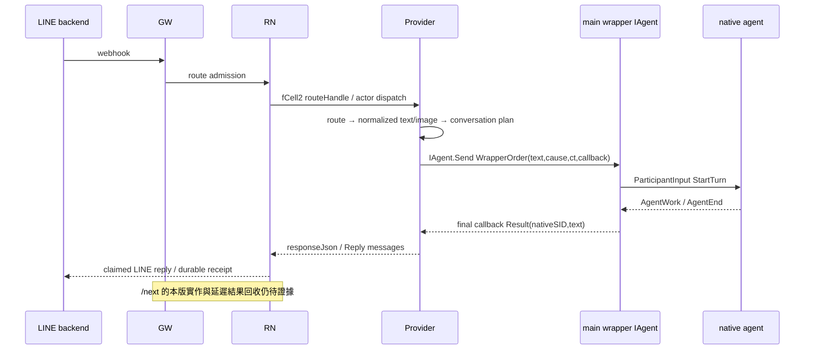

# M018 Fodex LINE Provider：SA／SD、操作與驗證邊界

日期：2026-11-03（Asia/Taipei），證據截止 **10:00 +08:00**。狀態：**交接草稿；已按目前實作核對行號，runtime 驗收阻塞，不是通過紀錄**。

## 任務與權威

已重讀 [評估全文（含 UPDATE）](../../202610/20261031/00014.M018.evaluation.txt)。本輪分工為 sub-4 開發、sub-5 測試、sub-6 文件；舊評估內 sub-1/2/3 是歷史分工。文件依 [開發 handoff](M018-fodex-dev-handoff.md)、[測試 handoff](M018-fodex-test-handoff.md) 及目前 source 更新。兩份 handoff 尚在進行中，已有編譯失敗／修正／重跑紀錄，尚無 READY 或完整測試結果。

本輪只寫本文件；操作步驟併入本文件，不擴散修改使用文件。不改 PTC 專案、目標 provider、測試、歷史 append-only 文件，不建立 subagent，不自行 commit/push。使用者本輪的明確範圍優先於 `G:/PulseTrade.fs/AGENTS.md`、`GEMINI.md` 的一般 log／commit／push 規則；該 repo 僅作唯讀來源。

來源以 `F:/fodex/Fodex.Supervisor/Fodex.Supervisor.fsproj` 的現行 `Compile`、Contract 的 `concepts.fsx`、`Start-M018.ps1`、`WrapperIAgentDemo.M018.fsx`，及 `G:/PulseTrade.fs/misc/line_bot_rn_nuget.multimedia.multisession.fodex.fsx` 為準。`None`／Archive 與舊 README 的測試數字不作本輪實作或驗收證明。Fodex root 目前沒有 AGENTS／GEMINI／README；已讀適用的 PulseTrade root 規範與 README。

## SA：問題、邊界與決策

使用者痛點是 COMM 已送出卻不知 agent 是否真的接收。保留 LINE backend → GW → RN → Provider 入口，將 Provider 到 agent 的控制改為 `IAgent<string,obj>` 對 main wrapper actor 的直接呼叫，再由 wrapper 管理 native agent 與回合結果。Provider 不以 agent 自行 blocking 收 COMM 信箱作為這條主路徑的完成依據。

評估原文第 2 點需與 UPDATE 第 7 點及現行實作一起解讀：目前開發 handoff 選擇 **IAgent direct＋final callback**。舊 execution transcript 提過 agent 前景 COMM receive；那是歷史理解，不能當作本版能力。M018 composition 內自己的 Fodex order hub 供 main 派工使用，也不等於 PTC COMM 信箱。

| 責任 | 持有／輸入 | 可證明的邊界 |
|---|---|---|
| LINE backend／GW | webhook、簽章、入口 admission／route | 不由本文件 agent 修改或發送真 LINE 訊息 |
| RN | LINE event store、route、actor dispatch、reply claim／receipt | RN reply receipt 的 accepted 才是 LINE API 接受；Provider 回傳文字並不等於 LINE 已接受 |
| Provider shared library | 解析 text/image、conversation、batch、媒體存取與 response JSON | 沿用 almighty 的 library mode／factory seam；目前 almighty／core 已有他人 dirty |
| Fodex provider | conversation＋target 對應 runtime、IAgent submit／cancel、final callback | 不把 Send 成功當成 native 已開始 |
| main wrapper／native | ReAct graph、排程、main role、native turn、AgentEnd | 由當前 DLL 與 actor runtime 執行；需實測證明 |

SA 不變事項：同 conversation／target 延續同 wrapper；不同 conversation 隔離；callback 不可串錯 route；取消確認前不得放下一個請求進入同 runtime；timeout／late callback 不得回成下一輪答案；停止只能釋放本輪持有的資源。多媒體目前可核對的是 **文字、圖片及 text/image batch**；沒有音訊／影片支援證據。

## SD：實際資料流與 API



Contract：`F:/fodex/Fodex.Supervisor.Contract/concepts.fsx:701` 定義抽象 `IAgent`，`:768` 起提供 Start／Stop／Send／GetSessionId。實作 `F:/fodex/Fodex.Supervisor/IAgentFodexFunV200.fsx:49` 的 Send 只執行 actor `Tell` 後回 `Ok 1`，不能作開始或完成 ACK。`:45` 的 Start 則 Ask actor 的 StartAgent 回應；仍不能證明某一筆使用者 prompt 已開始。

`F:/fodex/Fodex.Supervisor/M017CompositionV300.fsx:15` 的 `startWithOutput` 建立 loop／native output／factories／order hub；`:47` 建立 root wrapper，`:49` 呼叫 `wrapper.Start()`，回傳 wrapper、loop、hub、remote owner、cleanup。`:37` 的 cleanup 依序停 wrapper、清理 subagents、停止 hub。`WrapperIAgentDemo.M018.fsx:144` 延遲建立 composition；`:156` 接原始 I/O receiver 後啟動。`Start-M018.ps1` 只啟動 Console demo，**不是 LINE Provider launcher**。

### 目標腳本與 M018 式程式的位置（10:00 核對）

以 `G:/PulseTrade.fs/misc/line_bot_rn_nuget.multimedia.multisession.fodex.fsx` 為準：252 行、16,200 bytes，mtime `2026-11-03T09:54:02.9025581+08:00`，SHA256 `5D96158EA8079C311C5C0B9D9489F954991EFC6724B2D4C25B40E5D4DF835E05`。這是證據截止時的 source snapshot；開發後續若修改，需按新 hash 更新本節：

| 位置 | 已觀察到的程式 |
|---|---|
| `:4`、`:12` | 完整 `defaultArgumentsText`、library-mode 載入 shared almighty provider |
| `:16` | 仍載入 LineAgentV301 提供 Settings／Runtime 與 references；runtimeFactory 已改呼叫本腳本 startM018，沒有委派 LineAgentV301.start |
| `:42` | supervisorEvidence：核 runtime Assembly.Location、現行 Compile／ProjectReference mtime、版本與 SHA256 |
| `:74`、`:95`、`:97` | **腳本內 startM018** 建立 node、model catalog、native args、composition；將回傳 main 明確標型為 `IAgent<string,obj>` |
| `:99`、`:107` | **腳本內 submit**：HumanInit → PinEventRecorder → `wrapper.Send(WrapperOrder(...))`，final callback 回傳文字 |
| `:108`、`:114` | **腳本內 cancel**：`wrapper.Send(WrapperRequest("/cancel",...))`，等待 callback 確認 |
| `:117`、`:121` | semaphore requester、retire、idempotent DisposeAsync、composition／node 清理 |
| `:136`、`:149` | conversationRef 解析、`(conversationRef,target)` runtime cache |
| `:189`、`:197`、`:200` | RequestAsync／session 選取 owner 檢查／reset |
| `:208`、`:238`、`:250`、`:251` | direct lifecycle、settings、runtimeFactory → startM018 → Provider.runWithFactory |

09:52 開發 handoff 已記搬入工作目錄，但尚未 READY；上述是更新後的 source 證據，不能取代編譯與 runtime 驗證。`LineDirectV301Core.fsx:11` 的 semaphore 序列化同 runtime 請求，取消最多等 30 秒確認，失敗 retire。Provider runtime 的 RequestAsync route 用於外層關聯；requester 以每次 callback closure 防串答，並非以 route 為 key 的持久化 mailbox。

compiled wrapper 的 `WrapperAgentV300.fsx:253` 記錄 `ParticipantInput(StartTurn,...)`、`:695` 處理匹配 active cause 的 AgentEnd，`:702` 檢查 native SID／error 後呼叫 completeJob；`NativeAppServerV300.fsx:279` 只在 `turn/completed` 對應成功回合產生完成 AgentEnd。item/completed／AgentWork 不等於回合完成。

### LINE／RN shared path

唯讀來源 `G:/PulseTrade.fs/misc/line_bot_rn_nuget.multimedia.multisession.almighty.fsx`：

| 位置 | 行為 |
|---|---|
| `:479` | LINE event parser 只接受 text／image，其他型別拒絕 |
| `:2016`、`:3075` | requester 與 ProviderAgentRuntime factory seam |
| `:3146`、`:3164` | RouteEventReader；正式模式依 route 從 LINE store 讀取、解密 payload；normalizedEventReader 是可注入的測試切點 |
| `:3264`、`:3293` | request plan 呼叫 transport；記 session provenance；timeout／failure 轉成失敗文字，Session=None |
| `:3537` | 圖片下載、JPEG／media store、capability URL、image request；回圖片＋文字，清除暫用 bytes |
| `:3691`、`:3733` | LineEchoActor 收 `fCell2<string>`、取 route、等待 ProcessAsync，將 responseJson Tell 回 RN sender |
| `:4643`、`:4733` | runWithFactory、provider actor、dynamic image registration；ready 不代表 agent turn 成功 |

`line_provider_almighty_core.fsx:228` 建立 `line-agent-turn.v1` envelope：conversationRef、requestedParticipantId、turnNumber、payloadKind、userPayload；response contract 為繁中、最多 5 則、每則 5000 UTF-16 code units。`:294` 由 explicit target／pinned target／default target 決定 dispatch。logical wrapper GUID 與 native Codex SID/TID 不可混稱；目前 cache 在 process 記憶體，不能宣稱 Provider 重啟後恢復同一 wrapper。

圖片交給 agent 的路徑仍是 **文字 envelope 內的圖片 URL／描述**：shared `imageParticipantRequest` 在 `:3093`，native app-server 的 `NativeAppServerV300.fsx:239` 建立文字 input，再於 `:243` 呼叫 turn/start。這不證明模型已讀像素或可直接接受 image attachment。sub-5 圖片案例 `M018LineFodexE2E.fsx:119` 明示不要下載／辨識，只驗 normalized image publication、image envelope、真 native 回答與 typed image＋text reply；即使通過，也不驗真 LINE 下載、公開圖片 URL 可達或視覺理解。

### reply、timeout 與 /next

RN current source `G:/PulseTrade.fs/Libs/PulseTrade.Comm/src/PulseTrade.Comm.ResourceNode.Line/LineRuntime.fs:187` 明示 LINE reply 沒有 retry-key 契約，claim commit 後只送一次；`:207` 處理 claim／send／receipt。`G:/PulseTrade.fs/Libs/PulseTrade.Comm/src/PulseTrade.Comm.GW.Host/LineResourceGateway.fs:115` 描述 `line_message_reply` 與 `line_message_reply_status`，accepted 代表 LINE API 接受，indeterminate 不可換 requestId 盲目重送。

**/next 尚未核實**：目前對 PTC 的 current `*.fs*` 來源未找到 `/next` literal；Provider 初讀也沒有延遲答案佇列。這不證明部署的 GW 沒有該功能，但不能宣稱「已保留可用」。participant timeout 預設 50 秒，shared actor 外層 deadline 最多 58 秒；現有 direct requester 會取消並等確認，故不能假設稍後 `/next` 可以取回那筆最終答案。需要測試交接提供真正 handler、儲存 authority、pending→complete／失敗／重複 next／跨 session 隔離的證據。

另有較早的 timeout 邊界：`G:/PulseTrade.fs/Libs/PulseTrade.Comm/src/PulseTrade.Comm.ResourceNode.Host/LineActorDispatch.fs:118` 的操作 cancellation 為 25 秒，`:138` 對 provider Ask 為 20 秒，timeout 轉 deferred。這與 provider 50 秒設定不同；若只用測試本機 actor 的較長 Ask 成功，不能宣稱正式 RN 長回合已可用。不得為消除缺口而在本輪修改 PTC。

## DLL 來源、版本與建置核實

初讀時間：2026-11-03 09:50～09:52 +08:00。Fodex branch=`master`，HEAD=`ef05a30cb4453a44707fd9443023a668ee5a0e79`，worktree dirty；commit 不能代表工作目錄內所有程式。

| 項目 | 初讀本機觀察 |
|---|---|
| implementation | `F:/fodex/Fodex.Supervisor/bin/Debug/net10.0/win-x64/Fodex.Supervisor.dll` |
| implementation identity | assembly/file `0.0.1.0`；product `0.0.1+ef05a30cb4453a44707fd9443023a668ee5a0e79` |
| implementation hash | SHA256 `7F1593E54645B346E88C6AB735C64238A3C86125F1DB8DBD14EB0737BB907054`；mtime `2026-11-03T09:14:32.2653568+08:00`；2,001,408 bytes |
| contracts | 同目錄 `Fodex.Supervisor.Contracts.dll`；assembly/file `0.0.1.0`；SHA256 `344DC4BDAB955C63E1E22B353F77D7AF6510CAEE1A59969FFFCEA1061B011486` |
| source project | Supervisor／Contracts `<Version>0.0.1</Version>`；Supervisor `net10.0`／`win-x64`、ProjectReference 指向現行 Contracts |
| resolver | 初版 `LineReferencesV301.fsx:6`／`:18`／`:33` 指向 Debug（RELEASE 條件另選 Release）、Contract＋Supervisor DLL、AssemblyDependencyResolver；M018 `M017References.fsx:3` 同樣預設 Debug |

`V301` 是 adapter 命名；`3.0.0` 是部分 FodexFun registration/pin 版本；`0.0.1.0` 是 assembly identity。三者不可互代。檔案存在、mtime／版本相符或 bin／obj hash 相同，也不足以證明最新 dirty source 已完成 build，或正在跑的 FSI 已載入該 DLL。需開發交接給出本輪 build command／結果，測試交接提供 runtime Assembly.Location／identity／SHA256 及與本輪 build 的對照。文件 agent 不建置／啟動／停用任何 runtime。

新增的 supervisorEvidence mtime gate 會遞迴檢查 fsproj 的 Compile／ProjectReference，拒絕缺檔或比 implementation DLL 更新的 source；它尚不是 source-content manifest，也不能證明已載入 Contracts／所有 dependencies 都是最新。需要本輪 build 紀錄及 runtime evidence 補強，不能只憑「gate 沒報錯」下結論。

09:55 開發 probe 證據已讀：`G:/PulseTrade.fs/temp/sub-4/m018-fodex/assembly-probe.stdout.log` 顯示 Supervisor／Contracts 實際 Assembly.Location 都是上表 Debug 路徑，implementation hash 同上；mtime gate 通過。這是獨立 FSI **載入核實**，尚非 agent 啟動或本輪重新 build。probe 同時顯示 Akka `1.5.73.0` 由 NuGet 1.5.73 載入、SqlClient `7.0.0.0` 由 NuGet **7.0.2** 載入；Supervisor fsproj 的 SqlClient PackageReference 是 **7.1.1**。相同 assembly identity 不保證套件內容一致，此差異須依真 runtime 測試判斷相容性。Proc.Supervisor 的 `EXPECTED=1.572.10.0` 只是 reference expectation，不是其 runtime 已載入證據。temp 檔是當次診斷位置，長期追溯以開發／測試 handoff 記錄與本節摘錄為準。

09:59 文件端另做只讀核對：Supervisor **bin／obj Debug implementation DLL SHA256 相同**，都是上表 `7F1593…907054`；遞迴 Supervisor／Contracts fsproj 的現行 Compile 加 project 檔共 74 個 inputs，mtime 比 DLL 更新者 **0**。最新 Compile 是 `WrapperAgentV300.fsx`（UTC `2026-11-03T01:14:09.3480456Z`）。這支持「預設 Debug output 與目前 active source 時序一致」，不冒稱本輪重建或 bit-for-bit source 對應已證明。

## 「送出／開始／完成」證據規則

| 階段 | 最小證據 | 不足以代替的資料 | 本輪狀態 |
|---|---|---|---|
| 入口送到 Provider | 同一 route 的 RN dispatch、Provider 接收，account／conversation 關聯 | health、registration ready | 待測試 handoff |
| 送到 wrapper | 同 route／request 的 HumanInit cause、IAgent Send 結果、wrapper 身分 | COMM send success、Ok 1 以外的開始推論 | source 已定位；runtime 待補 |
| native 開始處理 | 同 cause／wrapper／native SID 的 StartTurn 與 native turn/start 成功回傳 turn ID、turn/started 或可等價核對事件 | wrapper.Start、main 已建立、Send Ok 1；測試的 native-started 只表示 runtime 建立 | 待測試 handoff |
| wrapper 回合完成 | 同 cause 的 AgentEnd／final callback、native SID、文字結果，含 error/timeout 分支 | AgentWork Completed、中間 stdout、程序 exit 0 | source 已定位；runtime 待補 |
| RN／LINE reply 完成 | 同 route 的 provider response、RN reply claim／receipt；真 LINE 接受另需 accepted | 隔離 reply sink 收到文字 | 待測試 handoff；真 LINE 未授權本輪發送 |

模擬從 normalizedEventReader 進入可驗 Provider→IAgent→wrapper→真 native→reply sink；若省略 GW/RN transport、SQL decrypt 或真正圖片 fetch，就只驗那一段。不得稱完整 LINE→GW→RN E2E。多 session、圖片、batch、cancel、late callback、/next 均須逐項列是否實跑，不從同一 echo 案例外推。

### 本輪測試交接狀態

sub-5 的 automation runner 為 `F:/fodex/Fodex.Supervisor.Tests/M018LineFodexE2E.fsx`，以 library mode 載入目標、注入 normalizedEventReader 與隔離 reply sink，`start` 明確呼叫 **Target.startM018**，不是舊 helper.start。精確命令：`dotnet fsi --parallelcompilation- --debug- --exec F:/fodex/Fodex.Supervisor.Tests/M018LineFodexE2E.fsx`。結果與診斷根目錄為 `G:/PulseTrade.fs/temp/sub-5/M018-fodex-test/`；本文件 agent 只讀，沒有執行此命令。

截至 09:58：先前 target 的 FS0041／FS0039 已由開發修正，測試 fixture 的 compile 問題另由測試者修正。attempt06 實際 3 tests、1 passed／2 errored；該 1 passed 當時只是 `/next` 行為觀察，**不能算 `/next` 驗收通過**。修正 fixture 後 **attempt07 實際 3 tests、0 passed／3 failed**，在 Target.startM018 建立 native 前遇到 `System.IO.FileLoadException`：Argu `10.2.1.0` 與已繫結版本衝突（`0x80131053`）。shared provider 引用 FAkka.Argu `[10.1.400]`，Supervisor 使用 10.2.1。編譯／reflection probe／unit pass 並未揭露這個延遲 runtime 錯誤；本輪尚無成功的 wrapper submit、native turn 或 final reply。

失敗證據：`G:/PulseTrade.fs/temp/sub-5/M018-fodex-test/attempt07.stdout.log`、`attempt07.stderr.log`、`events.jsonl`；專用 DB `FodexM018TestSub5_42277a57116b4b28ab2baf70b5b2699c` 已 CREATE/DROP，無 native session。sub-5 另啟 target 的 `--verify-only --storage none` branch；它不是正常 cluster host 或完整 E2E。只讀 health 的 RN／GW HTTP 200 也不是此鏈路 E2E。Argu 修復及重跑結果仍待開發／測試交接。

09:59 更新：standalone `--verify-only` 已通過，但沒有加入 RN cluster／建立 main。測試者另以 `M018LineFodexE2E.CompatibleArgu.fsx` 在載入 target 前先參考 Supervisor 的 Argu.dll，以診斷後段；截至證據截止仍在跑。**這是測試專屬 workaround，不能撤銷原始 production 路徑的 Argu defect，也不是正式操作步驟。** 移除條件是開發在允許的目標腳本處理相容性，並讓原始 runner 通過。

## 操作

1. 先核開發 handoff 的 READY 與測試 handoff 的 evidence；本草稿不授權變更正式 RN/GW 設定。確認已可達的 RN bootstrap、現存 LINE catalog／加密 SQL credential path、SQL Integrated Security 存取、Codex CLI 登入與目標 workspace；只核路徑／存在性，不輸出 secret 值。
2. 依開發者提供的 canonical Debug build 結果核 DLL。開發／建置者的命令為 `dotnet build F:/fodex/Fodex.Supervisor/Fodex.Supervisor.fsproj -c Debug --no-restore`；正式執行前檢查實際 restore 需求及既有 FSI 鎖檔，不由本文件 agent 執行，也不停止他人程序。
3. 在 Visual Studio FSI 開啟目標 fodex `.fsx`，修改檔頭完整 `defaultArgumentsText`，全選執行。初讀 defaults 的 RN bootstrap 為 `http://127.0.0.1:8799/resource-node/healthz`、Provider Akka `127.0.0.1:15977`、Fodex DB `FodexM018`、model `gpt-6.1-sol`、effort `medium`。這些是腳本預設，非目前服務可達證據；port 必須由操作者確認未被其他 provider 使用。
4. 觀察 `echo_line_bot_rn.status=ready`、actor address、`agent_transport=fodex-v301-direct`、圖片 provider ready；只代表入口／registration ready。後續先用測試者的隔離 ingress／reply sink，核同 route 的送出／開始／完成與 runtime DLL 身分。禁止將 raw payload、catalog credentials、媒體 capability URL、私鑰內容貼入日誌。
5. `**status` 看 conversation 偏好；`**use <participantId>`／`**release` 選定／解除固定 target；`**newagent` 建立 direct runtime；`**listagent` 列現存 logical wrapper IDs；`**setagent <logical-wrapper-GUID>` 選取剛建立且屬於本對話的 runtime；`**reset` 重置對話並釋放所屬 runtime。這些拼字以 shared provider `:1715` 的 parser 為準；目前 direct 提示文字中 `**list_agent`／`**agent` 與 parser 不符，不能照提示使用。不要將 logical wrapper ID 當 native SID 傳 resume／kill。`**newagent_next` 只查 provisioning 狀態，與 `/next` 取回未完答案不同；direct 模式沒有 mailbox readiness handshake。
6. 文字／圖片可直接形成單輪；text/image batch 用 `**<participantId<` 開始、逐則送入文字／圖片、`**>>` 封存送出；`**cancel` 是 batch 取消，不等於 native `/cancel`。batch parser 在 shared provider `:1715`，容量／timeout／交易 side effect 的保證不能由此語法說明外推。
7. 自己啟動的 provider 以 Ctrl+C 結束；確認本次建立的 node／hub／native 都已釋放，以測試 handoff 的 PID／port ownership 與 cleanup 結果為準。不自動停止既有 PTC／他人 FSI。

Automation 才使用下列形狀；參數為 sparse overlay，由同一 Argu defaults fallback 決定。必須先換成測試者確認的隔離路徑／port，不能直接拿正式 LINE 做 smoke：

```powershell
Read-CodexStdout {
    dotnet fsi --parallelcompilation- --debug- --exec `
        G:/PulseTrade.fs/misc/line_bot_rn_nuget.multimedia.multisession.fodex.fsx -- `
        --fodex-working-directory F:/fodex
}
```

這是長駐程式範例，stdout 仍須先 capture 且每次讀取嚴格小於 20KB；unified exec 若回 session id，用 write_stdin 接續，不能重啟第二份。一般互動仍以前述 VS FSI defaults 方式為主。

## 待補與驗收邊界

- sub-4：Argu 10.2.1.0 runtime 載入衝突修復；目標腳本內 M018 式組裝／IAgent submit／cancel 的最終行號、build 結果、載入 DLL provenance、對外行為差異。
- sub-5：精確 runner／command、executed/passed/failed/skipped、真 native turn、runtime DLL hash、route→cause→native SID→callback→sink 關聯；測試資源清理證據。
- 多 session 同／異 conversation、multi-turn、文字／圖片／batch、取消與 late callback、failure/reset；每項分開記錄。
- `/next` 的本版實作與 pending answer authority、真正 GW/RN ingress、真 LINE API accepted 均未核實；真 LINE 發訊不在本輪測試授權內。

## 本文件作業紀錄

- 2026-11-03：先讀指定評估全文及 UPDATE、規範、目前 fsproj/API／provider，保留兩 repo dirty；最初 handoff 不存在，後續已讀兩份計畫與更新。只新增本文件。首次 skill bootstrap 讀取未包 guard，其後 shell 使用循序 Read-CodexStdout；幾次合併讀取超過 20KB 被 guard 拒絕，改縮小 selector／range 重新 capture，沒有讀超限 raw。曾用錯 Contract 單數專案檔名，已改核正確 `Fodex.Supervisor.Contracts.fsproj`。本文件是靜態核對與操作草稿，沒有執行 build、產品測試或服務操作。
- 10:00 已重新核對目標 source hash／行號及兩份 handoff；開發未宣告 READY，測試尚有 runtime blocker。三個文件連結均存在；本文件保留 untracked、未 stage，沒有 commit/push。
- 文件驗證：`G:/PulseTrade.fs/misc/checkSensitiveText.fsx --path F:/fodex/notes/202611/20261103/M018-fodex-SA-SD-validation.md --fail-on high --max-info 0` exit 0，files=1／High=0／Medium=0／Info=2。strict UTF-8 decode 成功、UTF-8 no BOM、無 NUL／U+FFFD；這些只驗文件品質，不是產品測試。

## SECOND-ROUND Correction：授權來源、canonical log 與驗收規則

本節及其後續追加內容為第二輪最新狀態；前文保留第一輪原始紀錄，不再視為目前驗收結論。

Correction：第一輪「不 commit/push」與「以 F notes 代替 G canonical log」是當時主代理的派工限制，並非終端使用者指令。前文「使用者本輪的明確範圍優先於 G repo log/commit/push 規則」的歸因不正確。第一輪缺少 G canonical pre-work/Operations 的流程偏差保留，不倒填舊時間或偽造先前 log。第二輪現在依授權補正式 canonical log／必要 append-only DevLog，並由文件 agent 擔任唯一 G index owner 做 exact-path stage/commit/push；F repo 文件/handoff 不自行提交。

本輪 canonical log：G:/PulseTrade.fs/log/20261103/20261103110227.m018-sub6-second-round-closeout.log，自實際建立時間開始記錄。收尾只納入 sub-4/sub-5 SECOND-ROUND handoff 明確列出的 G owned paths，以及此 log／必要 M018 DevLog append。禁止納入既有 almighty、Libs、LINE docs、PCSL 或其他 owner staged/dirty；禁止修改 PTC 專案/服務/設定、branch/worktree、reset/restore/amend。起點 index 空，後續每次提交前重核。

目前 SECOND-ROUND dev/test handoff 尚未追加；文件先準備，等待本輪原始入口真 native 與正常 provider host 的結果。第一輪 19 unit、diagnostic preload 3/3、verify-only 不作本輪原始產品入口驗收。後續須補根因、target 修復、實際 source 行號、runtime DLL provenance、送出/開始/完成、host、媒體/session/next 邊界與失敗殘留。

### SECOND-ROUND SA/SD：根因與正式入口修復的判定

第一輪已保存的原始入口結果是 Argu failure；只補 Argu 後再遇 MCP Core 2.3/2.2 identity 衝突。測試專用 CompatibleDeps 預載才走通後段真 native 3/3，這可定位根因，但不能替正式 target 驗收。根因為單一 FSI AppDomain 先載入共享 LINE provider 的較舊相依，之後 Supervisor 延遲使用不相容 assembly identity；compile／verify-only 沒有進到那個 runtime 路徑，故不能揭露問題。

第二輪正式 target 已調整為 Supervisor-first：在載入共享 LINE NuGet graph 前，由 target 自己載入既有 LineAgentV301/LineReferencesV301 的正常 Debug/RELEASE 搜尋路徑與 resolver，並明確 reference Supervisor 同 output 的 MCP、FCell2、FsPickler、Proc.Supervisor 等。這是產品入口責任，不再要求操作者或測試 runner 額外先載入相依；沒有以 NuGet config、複製 DLL、改 PTC/shared almighty 或清 cache 處理。最終 source hash、行號、實際載入 identity 及原始入口結果待本輪交接補實。

SA 不變：LINE backend -> GW -> RN -> provider actor -> target runtime -> IAgent<string,obj>.Send -> main wrapper -> native agent -> final callback -> provider typed reply -> RN claim/LINE receipt。依賴 binding 修正不改 route authority、conversation/target 隔離、wrapper queue/cancel barrier、reply claim 或圖片 delivery 契約。

SD 驗證切點必須分開：

- 原始產品入口：測試不能在 #load target 前加入診斷 #r；需透過 target.startM018 真建 wrapper/native 並完成請求。
- 正常 provider host：執行 target.run 的非 verify branch，核 cluster/provider registration/actor address 與所屬資源回收；library-mode actor 測試不代替此項。
- full ingress/reply：正常 host ready 仍不能代替正式 GW/RN admission、SQL decrypt、reply receipt 或 LINE API accepted。
- 多媒體：image envelope／body bytes／preview 與公開 HTTPS delivery、像素辨識分開；多 session 要有同 session 延續／跨 conversation 隔離，不能只看 wrapper 數量。
- /next：第一輪在 provider 只是普通 prompt；不得把新一輪 native 回答或 **newagent_next 當 pending-reply continuation。未取得正式 handler/authority/receipt 證據前維持未驗收。

操作更正：重設自己的舊 FSI session 後，以 VS FSI 全選原始 target、修改其完整 defaultArgumentsText；不要手動載入 CompatibleArgu/CompatibleDeps 作產品步驟。automation 仍使用原 target 的 dotnet fsi --parallelcompilation- --debug- --exec 及 sparse overrides。不要停止他人 FSI、改既有 PTC 服務設定、或把正式 LINE 發訊當本輪 smoke。

### SECOND-ROUND Correction：FSI 子腳本初始化才是最早綁定邊界

依 sub-4 的 SECOND-ROUND READY 與 canonical log（11:10），前述「只前移 references／在 target 內 eager bind」仍不充分：simple-name #r 可能解析到舊 NuGet；實體 #r 是 compiler reference，且 target 本身的初始化仍晚於已 #load 的 almighty child。因此兩次原始入口重測仍失敗，保留在開發 round2-original-e2e-attempt1/attempt2 logs，不能省略成修一次即成功。

目前修復把綁定前移到 **第一個 #load child**：新增 misc/line_provider_fodex_references.fsx，選與 LineReferencesV301 相同的 Debug/RELEASE 絕對 DLL 路徑；其 :29 的 canonicalDependencyEvidence 在 almighty child 初始化前於 Default context 執行 LoadFromAssemblyPath，逐顆比對完整 identity。target :1 先載入該 helper，:2 保留 evidence alias，:15 才載 shared provider。helper 只處理相依綁定；M018 runtime／IAgent submit／cancel 留在 target 本體，符合程式位置要求。

本次 source（與 SECOND-ROUND READY 相符）：target SHA256 FE0E1EEAFEC190E2447A1AD9EEB56A72922EAD7E1022BB273960D810BC404338；helper SHA256 55E4C7F6BA92717452C3D363038EF0752655D81C027391E5B06AB57718BC80D2。

| target 程式位置 | 實作與驗證重點 |
|---|---|
| :1 / :15 | canonical references child 必先於共享 almighty child 初始化；全新 FSI 執行，不使用 diagnostic runner preload |
| :7 | 完整 defaultArgumentsText，沿用 shared Argu sparse override；使用者不手刻 argv |
| :44 | supervisorEvidence：implementation Assembly.Location、active Compile/ProjectReference mtime、version/hash |
| :76 / :97 / :99 | startM018 -> M017CompositionV300.start -> explicit IAgent<string,obj> main wrapper |
| :103 / :109 | HumanInit cause -> PinEventRecorder -> IAgent.Send WrapperOrder -> final callback；Send Ok 1 仍非 native ACK |
| :110 / :116 | cancel 仍經 IAgent.Send WrapperRequest("/cancel",...) 等 acknowledgement |
| :138 / :151 | conversation reference 與 (reference,target) runtime cache |
| :252 / :253 | runtimeFactory 指向本體 startM018；run 注入既有 Provider.runWithFactory |

窄 probe 已見 canonical Debug output：Argu 10.2.1.0、MCP Core/Protocol/AspNetCore 2.3.0.0、FAkka.Shared 10.2.6.0、FCell2 10.2.2.0、FsPickler 10.2.0.0／Json 10.2.2.0、Proc.Supervisor 1.572.10.0。此時只是 runtime binding/source gate，原始真 native 測試仍在執行；不先寫通過。

Git closeout 的 handoff allowlist 已明列：G target、上述 G helper、sub-4 canonical log 20261103110223.M018-fodex-runtime-deps.log、本文件 agent 的 canonical log 20261103110227.m018-sub6-second-round-closeout.log，以及只含 M018 append 的 doc/DevLog.md。sub-5 目前 SECOND ROUND PREPARED 明說 G repo 無本輪 log/test source 改動，故不把其 F log/測試或第一輪其他 G 檔案混入。

### SECOND-ROUND 原始入口修復驗證（開發 11:12 新結果）

原始 M018LineFodexE2E.fsx 以目前 target/own helper 直接執行，**2 executed / 2 passed / 1 ignored / 0 failed / 0 errored、exit 0、47.1261921 秒**；沒有 CompatibleArgu/CompatibleDeps，也沒有 runner 先載診斷 #r。/next 是 ignored/pending，沒有被計入 pass。這是本輪新測試，不是第一輪 19 unit 或 diagnostic 3/3。

證據：G:/PulseTrade.fs/temp/sub-4/m018-fodex/round2-fixed-original-e2e.stdout.log（summary line 74、runtime Dispose line 77、專用 DB DROP line 78）及同名 .stderr.log；開發 handoff SECOND-ROUND READY 已列 exact paths，原始測試 source SHA256 A3090F7ED7D561CF9D50FE9654F2A3ECC8E1CD39D642CDE091ABBC52784E4302。該結果驗 normalized backend seam -> production provider actor -> inline startM018/IAgent -> 真 native -> typed reply；同 conversation memory、跨 session 隔離／並行、route dedup，以及 image envelope/typed reply/JPEG body/preview 均在這兩個案例內。它沒有驗正常 provider host registration、正式 GW admission/LINE Reply API 或 /next continuation。sub-5 的正常 host／獨立重測仍待最終交接。

runtime loaded-dependency 已在這次 E2E 印出 Supervisor／Contracts／Argu／MCP Core／Shared／FCell2／Proc／SqlClient 的 canonical Debug 路徑，不再只是 reflection probe。DLL 本輪未重建，implementation/Contracts hash 仍分別是前文完整 7F1593...907054／344DC4...11486，assembly identity 0.0.1.0、product 0.0.1+ef05a30cb4453a44707fd9443023a668ee5a0e79。前輪 SqlClient NuGet 7.0.2 的觀察須更正為本輪 **canonical Debug output**，assembly 7.0.0.0、product 7.1.1+29ce2d856cb5a9450f79ea62c0afc744fd337fde、SHA256 F4C6A8822A5D078ED9D3466D05A0936EBA301135AA75014D02C8D53F11CD9F0F。

送出／開始／完成的解讀維持精確：測試 native-request 是 route/wrapper 請求邊界；target HumanInit/IAgent.Send 有對應 source，Ok 1 仍只等於 Tell；native-started 是 wrapper/runtime 建立，不是每一 prompt 的 turn/start ACK。真 native 回答經相同 route/wrapper 的 final callback 與 typed reply assertion 完成，證明已執行的這些回合確實處理成功；若未保存逐筆 native turn/start receipt，不能補造 turn ID 或對所有後續請求推定已開始。

### SECOND-ROUND 正常 provider host：已實跑的範圍與最新驗收

sub-5 11:17 handoff 回報並已核 controller stdout：M018LineFodexHostE2E.fsx **1 executed / 1 passed / 0 ignored / 0 failed / 0 errored、50.6898611 秒**。這次是另外啟動原始 target 的正常 run() child，沒有 LibraryMode 或 --verify-only；不是測試內直接 new 一個 provider actor 冒稱 host。

| 證據 | 本輪觀察 |
|---|---|
| 正常 host 啟動 | host-start pid=62776，實際 FSI=61072、native=19064；隔離 RN=12125／GW=12126／bootstrap=12129／provider=12130 |
| registration | 獨立 public SDK RN/GW cluster 達 Up；target 印 ready／actor address，圖片 catalog route 實際出現在隔離 GW registry |
| 輸入 | 專用 SQL DB 的 encrypted LINE route 經 LineStore.admitAsync 寫入 synthetic event，從該 route 讀回、解密；沒有 official LINE webhook／正式 GW 簽章 admission |
| 開始與完成 | RN ActorSelection 遠端送到實際 target actor，真 native 最終回答 SUB5_NORMAL_HOST_NATIVE_OK；typed fCell2 disposition=reply／msgOut 與 marker assertion 通過 |
| reply 捕捉 | route=052c507e8dfb43ef94d39ca3fdc43a44；只在本地捕捉 typed response，沒有 LINE reply/push 或真 LINE accepted receipt |
| 清理 | controller 結束自有 host subtree；PID+creation time 回讀 RemainingOwnedProcesses=0，exact test DB=0、login=0；這不等同正式 Ctrl+C 優雅關閉已驗 |
| 既有服務觀察 | SPA 53384／RN 16660／GW 2408 前後 PID 相同、Running；RN8799／GW8797 health=ok；只聲明這些讀回結果 |

永久證據：F:/fodex/notes/202611/20261103/M018-fodex-test-round2/host-controller.stdout.log（host-start line 3、typed reply line 5、PASS line 6、Expecto summary line 7），及 host-controller.stderr.log、summary.json、cleanup.json、owned-processes.json、owned-listeners.json。已程式核對 summary 的 TargetSha256／HelperSha256 與目前 G source 相符；其中 TestsSha256 指 **原始 native E2E script**（A3090F...E4302），不要誤標為 host fixture 的 hash。host fixture 目前 source hash 0F702EF5182C30AF0792ED8C3F3E0F91627CDDCFD74B3741AF23046C0BEE8FB1，測試副本與版本交接以 sub-5 最終 evidence 為準。

最新分層結論：正式 target 的 Argu/MCP 原始入口缺陷已由產品自身 references child 修復，原始真 native 2/2、正常 provider host 1/1 都有本輪新證據。仍不接受「完整 LINE E2E 已完成」：未經 official webhook/正式 GW admission、正式 RN dispatcher timeout/claim/LINE API accepted；host fixture 的遠端 Ask 使用 90 秒，不證明正式 20 秒 dispatch deadline 內皆能完成。圖片 case 驗 envelope/bytes/preview/typed reply，未驗公開 HTTPS/Dynamic GW delivery／模型像素辨識。/next continuation 明確 pending/ignored；不要把 **newagent_next 或普通 native prompt 當 next。

本輪修復未改 DLL／PTC／shared almighty；Release 路徑只依條件選擇，實測 DLL provenance 是 Debug。正常使用請啟新 FSI 執行原 target；不要額外執行診斷 preload，也不要由 Start-M018.ps1 誤當 provider launcher。啟動與停止只處理自己的程序／ports，對既有 PTC 服務不操作。

政策殘留：第一輪 G:/PulseTrade.fs/temp/sub-5/M018-fodex-test 的刪除曾被 automatic review 拒絕（blocked by policy），本輪不重試或繞過，原 scratch/media/native trace 保留；它不是永久驗收 authority。第一輪與本輪結果分開保留，不回寫舊 FAIL/診斷數字。

### SECOND-ROUND FINAL：分層驗收及收尾 gate（11:25 核對）

sub-5 SECOND ROUND FINAL 已全文讀取：本輪共 **3 executed / 3 passed / 0 failed / 0 errored / 1 skipped**，即原始 native 兩案例＋正常 host 一案例；/next 未執行、不計 pass。原始兩個 wrapper=936b23d8-2fef-4dc3-8a14-d8dbb2d1bdf7／344f40c5-1ab5-40c9-8aa8-c07d022919b1，已 Dispose；本輪專用 FodexM018TestSub5_9f7e9fb5a3fd41cb96cf5159b02cd0c8 DB 已 DROP。正常 host 的 SQL login 非 sysadmin、無正式 PulseTradeLogging DB access，nlog_db_accessible=false 為隔離預期，不驗正式 DB logger。host test 的無 LINE authority credential 可能走既有 profile GET 路徑；因此本文件只保證沒有 LINE reply/push 或正式 token，不宣稱完全沒有 LINE HTTP 嘗試。

本文件、DevLog 舊 bytes 保留，並只 append；target/helper hash仍為上節 FE0E...／55E4...。本輪沒有重新 build Supervisor DLL，核實的是 source freshness＋現行 Debug DLL身份/hash＋真 runtime 載入與處理。產品驗收維持前節明定 synthetic 後段範圍，完整 official LINE／public media／/next／正式20秒deadline與優雅關閉缺口不變。

**canonical checker 例外需保留原始數字**：本文件 agent 的 final check raw exit=1、PASS=44/WARN=4/FAIL=3；FAIL 均為 notes_readonly_modify，分別是本輪明確要求追加的 SA-SD、dev handoff、test handoff。沒有改 verifier、刪 failed state、換 session 或重設 baseline。依本輪明確 append 授權採窄例外，並對照上一份 passed state逐檔驗原 bytes prefix SHA256：

| F notes 檔 | baseline bytes | baseline prefix SHA256 | 判定 |
|---|---:|---|---|
| SA-SD-validation | 24828 | 6F334D875DBE45E3DCE3F68115DD4466531E1459EC5B6C599676BCBF18B23C74 | 純 append，舊 bytes 不變 |
| dev-handoff | 11058 | 0A052D9E4E136DEDFF7E4272A35D1EA9A4B7341F6747F81793982703762C99CA | 純 append，舊 bytes 不變 |
| test-handoff | 21448 | 1F5834FD5052B8C93C657015C76C16CE5D14550B9DEB13B5E4021E6B7CF4195F | 純 append，舊 bytes 不變 |

raw failed state：G:/workspace/home/codex/scoped-47bb749c00ee50a9a71e201cafef3fd9c9953dedb00672ed2c0ca89604373a74.state.json.failed.json；同 session passed baseline 保留。範圍外未豁免 FAIL=0，不能對外改寫成 canonical FAIL=0。其餘 WARN 為 KM 未變、既有 dirty／未提交、全 repo traceability 缺口，不擴改其他 owner 文件。

另外，原 DevLog 已混用 CRLF/LF；本輪新 append 有一個 CRLF，被預設 git diff --check 視為 CR-at-EOL trailing whitespace，行內沒有 space/tab 尾空白。遵 append-only 不重寫舊段落；提交時以明示 CRLF-aware whitespace 檢查核真正空白，不修改持久 git config 或 canonical checker。

Git closeout僅限既定五個 G owned paths；commit前必看完整staged list、重新核 High=0／encoding及worktree-index一致；遇他人staged即停，不混commit。最終commit/push/readback稍後append。F repo本輪不commit。

### SECOND-ROUND staged gate 補充

目前 staged list 精確為兩個 misc source、兩份本輪 canonical log、M018-only DevLog，共五個核准路徑；DevLog diff 為 23 added / 0 removed，沒有其他任務 append。High=0/Medium=0（6files）與 strict UTF-8/no BOM/no NUL/no U+FFFD 通過。預設 CR-at-EOL 訊號已如上保留；明示 CRLF-aware diff check 仍 exit2，唯一剩餘項是 references helper :39 的 new blank line at EOF。這是格式觀察，非 canonical/encoding/security/runtime failure；為保持已測 source SHA 不由文件 owner改程式或重寫append-only內容，保留該空行。工作檔與 staged index 相同，沒有 source 在驗收後漂移。

### SECOND-ROUND policy residue 更新

來源提交 4509930d4d07965bcfe771be1028fc539bdad5f5 已推送 github/20261019_036.ptc_line_km，遠端相同 hash、ahead/behind=0/0。收尾嘗試只清自有 G:/PulseTrade.fs/temp/sub-6/m018-second-round 前已核 resolved literal absolute path、五個已知checker檔、無子目錄/reparse；automatic approval review 仍以 blocked by policy 在 CreateProcess 前拒絕刪除命令。整個命令未執行，目錄與五檔保留，不改方法/拆命令重試。此為新增政策殘留；第一輪 sub-5 scratch 的既有拒刪殘留亦保留。沒有將任何 scratch 混入 G commit。

### SECOND-ROUND CLOSEOUT FINAL：提交與遠端回讀（11:30）

- Source/validation commit：4509930d4d07965bcfe771be1028fc539bdad5f5，五個核准G paths，263 insertions/2 deletions。
- Canonical audit log-only commit：0ea647d89d5d5d27e77fabd91a1a1d210f043797，只追加 sub-6 log 13行，保存primary commit/push的真實結果及cleanup政策拒絕；未amend。
- 兩次都已push至github/20261019_036.ptc_line_km；最後ls-remote回讀0ea647d89d5d5d27e77fabd91a1a1d210f043797，HEAD...upstream=0/0。本輪五個G owned paths clean，index空；原有almighty、Libs/PTC、LINE docs、PCSL等他人dirty保留，沒有被stage/commit。branch/worktree未改。F repo未commit。
- 最新產品結論：原始入口真native2/2、正常provider host1/1，本輪共3 passed、1 skipped；明定synthetic後段scope通過。正式LINE API/official admission、公開媒體/pixel vision、/next continuation、正式20秒deadline與正常host graceful stop仍無驗收證據。
- Gate結論：scoped敏感High=0/Medium=0、strict UTF8/no BOM/NUL/UFFFD；canonical raw FAIL=3保留並依本輪明確授權append且三份prefix不變的窄例外處理，並未改稱canonical全綠。references helper EOF空行的格式觀察保留，source SHA與已測版本一致。
- Policy residue：automatic review以blocked by policy拒絕刪除 G:/PulseTrade.fs/temp/sub-6/m018-second-round，五份checker scratch保留；第一輪sub-5 scratch亦保留，兩者都不重試或繞過刪除，不混入commit。runtime的程序/DB/login清理依測試交接均為0，與scratch檔案保留分開陳述。

最終權威文件仍為本檔最新SECOND-ROUND段落、dev/test handoff之SECOND-ROUND READY／SECOND ROUND FINAL及兩份G canonical logs；第一輪原段落/FAIL/diagnostic evidence全部保留，不當作本輪正式入口驗收。

## THIRD-ROUND Correction：最新交付界線與必要依賴快照

本節及末尾 THIRD-ROUND FINAL 是第三輪最新狀態；前兩輪內容只作歷史，維持原 bytes，不回寫 PASS 或刪除 FAIL。第三輪開始的前 42541 bytes SHA256=5C8BE45F9BEA11C3C543D6A61DD2A6C518D7C305F56387B62377510B4C9CC043。

**交付界線更正：此前的 G target/own references commits 不是自含、可在乾淨 checkout 重現的 artifact。** target 使用 G 共享 almighty/core 的既有 dirty factory/provenance API，也載入 F 跨 repo helper/config/DLL。這些來源未全部包含於 G commits，必須同時具備下表目前工作目錄依賴。只能宣稱指定 F:/fodex＋G:/PulseTrade.fs workspace 的實測，不宣稱 clean checkout、獨立artifact、部署或公開LINE全鏈可重現。不得為補齊閉包而擅自stage/commit共享dirty或PTC。

已在第三輪起點 G HEAD=0ea647d89d5d5d27e77fabd91a1a1d210f043797 比對：HEAD 的 almighty 不含 ProviderAgentRuntime/runWithFactory，HEAD core 不含 AgentSessionProvenance。工作檔則有 almighty :3075 ProviderAgentRuntime、:4643 runWithFactory、:1013/:1249 RecordAgentProvenance，以及 core :96 AgentSessionProvenance。HEAD core 已有 FodexV301，不能籠統說整個Fodex transport DU不存在；缺口是新增factory/provenance surface。HEAD blob OID分別為 almighty d47805a060b92fc289c434d4571975138315d380、core 2e3fdda2f6caed0ea665cd77f78627a027b4e4a2。

### 必要依賴 paths／SHA256（第三輪11:35工作檔核對）

| 精確路徑 | 用途／版本界線 | SHA256 |
|---|---|---|
| G:/PulseTrade.fs/misc/line_bot_rn_nuget.multimedia.multisession.almighty.fsx | 既有dirty；factory/runWithFactory/RouteEventReader/provenance，未納入owned commit | 9E7DBFD9A5E4697D4B88AD83083441E14F0383228A73888E45F3DBD6AD2B1BC9 |
| G:/PulseTrade.fs/misc/line_provider_almighty_core.fsx | 既有dirty；request/response/session provenance/envelope型別，未納入owned commit | A25608430DF371075A609A9BB85B9BFA08AA25320726EB89AB2C5AE0C9FB78BE |
| G:/PulseTrade.fs/Libs/PulseTrade.Comm/scripts/ParseLine.fsx | almighty直接#load的既有parser；只讀，未改／未stage任何PTC | 3EF2509DC3A02626D8AB1F7A900448C6A53CE8047CEFB1E095D1C837C231584C |
| F:/fodex/Fodex.Supervisor/LineAgentV301.fsx | 跨repo既有Settings/Runtime及#load接線；F目前untracked，非G交付閉包；target不呼叫其舊start | 16359D9E37CDF4B3EDA1F2BB006E8914C20B1F0AD68092852C320614A1FA93FD |
| F:/fodex/Fodex.Supervisor/LineReferencesV301.fsx | canonical Debug/RELEASE output與resolver；F目前untracked | 163345A9A87283F13A5A4D7F02700342B9CDF4CD14CD4C27B99AF8F9208B1E8E |
| F:/fodex/Fodex.Supervisor/LineDirectV301Core.fsx | semaphore requester/cancel acknowledgement/retirement；F目前untracked | 60D599E9637F81223054B4E2951311142BD708BD51D7BEB39E592D786DBCE9E7 |
| F:/fodex/Fodex.Supervisor.Contract/LoggerAdapter.fsx | LineReferences直接#load的logger adapter | E513BE58F49844E1A4BD17662D3EE45EBF5FB3A041E9DE86842F1B98F9BACBB8 |
| F:/fodex/Fodex.Supervisor/NLog.M017.conf | LineReferences載入之logger config；F目前untracked，只記path/hash不揭露設定值 | 080245E71FA5EC2E53F3DD6EFACCC0414EBB5E3FF1764B4EB42EA5AE4CC277EC |
| F:/fodex/Fodex.Supervisor/bin/Debug/net10.0/win-x64/Fodex.Supervisor.dll | canonical implementation，assembly/file 0.0.1.0；非G產物 | 7F1593E54645B346E88C6AB735C64238A3C86125F1DB8DBD14EB0737BB907054 |
| F:/fodex/Fodex.Supervisor/bin/Debug/net10.0/win-x64/Fodex.Supervisor.Contracts.dll | canonical Contract，assembly/file 0.0.1.0；非G產物 | 344DC4BDAB955C63E1E22B353F77D7AF6510CAEE1A59969FFFCEA1061B011486 |

這是必要直接#load/config與主要自有DLL的精確快照，不冒稱已建立完整NuGet/runtime分發manifest。共同Ar gu/MCP/Shared/FCell2/Proc/SqlClient相依仍由既有F canonical output及NuGet graph提供；實際本輪載入位置以THIRD-ROUND測試證據為準。若未保存某依賴當時的hash，不把文件核對時的hash冒稱為runtime自行量測。

本輪只修兩個操作提示與own helper EOF，不改以上共享dirty或PTC、F helpers/DLL。最終source hash/行號、來源gate、原始native/正常host新結果，等THIRD-ROUND READY/FINAL後在末段追加；不沿用第二輪測試數字當第三輪通過。

### THIRD-ROUND READY：操作、程式位置與來源 gate

已全文讀第三輪開發READY及其行號Correction。本輪source變更只有兩個提示＋own helper EOF：target :215 正確提示 `**setagent <GUID>`，:216 正確提示 `**listagent`，分別對應shared parser :1750/:1721。請用**本對話剛建立的logical wrapper GUID**選取，不用native Codex SID或本文件歷史測試GUID。helper最後程式碼為 :38，先前 :39 是已移除的多餘空白行；正常final newline保留。第一、二輪「提示仍錯／helper EOF空白保留」從本節起已被這次owner修正取代，舊紀錄不刪除。

| target 位置 | 現行行為 |
|---|---|
| :1 / helper :29 | 第一個#load是own references child，於shared child之前做canonical binding/evidence |
| :44 | supervisorEvidence的implementation path/freshness/version/hash |
| :76 / :97 / :99 | startM018，M017CompositionV300.start回main，再明確標型 IAgent<string,obj> |
| :103 / :109 | HumanInit/PinEventRecorder後經IAgent.Send WrapperOrder；final callback完成文字 |
| :116 | IAgent.Send WrapperRequest /cancel，等待acknowledgement |
| :151 | createDirectRuntime/ProviderAgentRuntime factory（149是歷史行號） |
| :215 / :216 | 正確的setagent/listagent提示，非新增parser行為 |
| :252 / :253 | runtimeFactory呼叫本體startM018；正常run注入共享runWithFactory |

第三輪target SHA256 **6F4BA3E0228CE06158A530FBC2036D013613E5D1B22D748CA261B2466C25DF26**；own references helper SHA256 **7CD512627D9E0F77F2B603DDFD5E83BDC3268CDC5723FF93F9AF6E5BF51931BB**。source diff為2 insert/2 delete提示及1 delete空白行，`git diff --check --`兩個source paths exit0；strict UTF8/noBOM維持。middle、native、host結果分開：

1. **middle原入口：exit1，0 tests executed**。它 :4 額外先綁FAkka.Argu10.1.400；未改此測試或shared source。不能寫成原入口19/19。
2. 使用production helper作FSI startup load後，同一19案例 **19 run/19 passed/0 ignored/failed/errored，0.1528889秒**。精確automation條件：`dotnet fsi --parallelcompilation- --debug- --load:G:/PulseTrade.fs/misc/line_provider_fodex_references.fsx --exec G:/PulseTrade.fs/misc/line_bot_rn_nuget.multimedia.multisession.fodex.middle.tests.fsx`。這是middle執行條件，不能代替正式native/host原始入口驗收。
3. 正式target直接 `--verify-only --storage none` exit0，fixture/dependency/verify passed、non_host_bin_assembly_count=0；不啟動native/正常host。

上述第三輪middle/verify log位於 G:/PulseTrade.fs/temp/sub-4/m018-fodex/round3-{middle,middle-canonical,verify}.{stdout,stderr}.log，開發canonical log另有摘要。正式native/host各一次最後新結果由sub-5待追加，不借用第二輪3passed。

### 必要runtime依賴補充（不代表portable artifact閉包）

以下檔名均精確位於 **F:/fodex/Fodex.Supervisor/bin/Debug/net10.0/win-x64/**；與上節主要DLL／跨repo源碼表合讀。dev READY列出的24項來源／artifact manifest在 G:/PulseTrade.fs/temp/sub-4/m018-fodex/round3-source-dependencies.json，canonical開發log保留同一摘要；不把temp檔當獨立artifact authority。

| canonical output檔名 | SHA256 |
|---|---|
| Fodex.Supervisor.deps.json | 8A72B9C0DE5ACDA8A0B7A1D786B18CDDECB790BB9B491574864202837530939F |
| Argu.dll | 1C580F939B4C85D0AC050830BBC04065686ACCD004663C7CCE9CB788814640B4 |
| ModelContextProtocol.Core.dll | 80757DD4FDE30EAED2D99849915C5642D2428487059C711373690A3336CAA9B4 |
| ModelContextProtocol.dll | 45C63242855E574FD6BDB35AAD7D6E4AF16B67517E20A775B6D19103FAD38C63 |
| ModelContextProtocol.AspNetCore.dll | B89EFF1C8B94F81345D3281220C2B18ADB36061DCBAF63767303AF9BA393A85D |
| FAkka.Shared.dll | 84EDAB36106CD97533CC635D6B46BC265BEA13B0FA069085D41E76AA0275EAEA |
| FAkka.FCell2.dll | 7F8D26C6BEF76C95679E8EE2AC20A84DAE85DC9E3219FA2E44FC6EB871EF325F |
| FsPickler.dll | E9D415FE483E37927AF0EC923DD76E96F1DCCC0D20936DA5D39770B50A3D9E90 |
| FsPickler.Json.dll | 30C7DB49249AABDDAB69C966C9682A74A9A3CB080F84ED80D0ADA420259D7895 |
| Akka.Proc.Supervisor.dll | 72DA62B15E07EC03BF17019F5E95DC73479DD862A0C21441F900B5226E5C51A0 |
| Microsoft.Data.SqlClient.dll | F4C6A8822A5D078ED9D3466D05A0936EBA301135AA75014D02C8D53F11CD9F0F |

freshness/API權威project只讀核對：F:/fodex/Fodex.Supervisor/Fodex.Supervisor.fsproj SHA256 401E5462F7B60FB80C4A919C6AF28ED5CDD7DF4E119625EA250F2C6CF75D67C3；F:/fodex/Fodex.Supervisor.Contract/Fodex.Supervisor.Contracts.fsproj SHA256 7EDA285B8B49286D6324047D86AB50A767B8CF7968723B3FBAE76F02E5FC4FE3。未重新build、未驗RELEASE分支、未製作portable bundle。

### THIRD-ROUND 保留路徑與理由（不重試policy拒刪）

以下均為既有／本輪M018實際路徑；沒有將scratch或共享dirty混入owned commit。拒刪只保留，不拆命令／換方法重試。歷史`Ar gu`字樣是Argu的排版筆誤，正確assembly名稱均以Argu.dll及實際evidence為準。

| 精確保留路徑 | 理由／authority界線 |
|---|---|
| G:/PulseTrade.fs/temp/sub-6/m018-second-round/authorized-note-appends.json | 第二輪三份notes prefix/SHA純append proof；cleanup被automatic review以blocked by policy拒絕，五檔保留 |
| G:/PulseTrade.fs/temp/sub-6/m018-second-round/baseline-check.stderr.log | 第二輪baseline checker stderr（0 bytes亦保留）；同一拒刪scope |
| G:/PulseTrade.fs/temp/sub-6/m018-second-round/baseline-check.stdout.log | 第二輪baseline checker輸出；同一拒刪scope，不把baseline當final PASS |
| G:/PulseTrade.fs/temp/sub-6/m018-second-round/final-check.stderr.log | 第二輪final history gate錯誤輸出；同一拒刪scope |
| G:/PulseTrade.fs/temp/sub-6/m018-second-round/final-check.stdout.log | 第二輪raw PASS44/WARN4/FAIL3；同一拒刪scope，三FAIL與授權例外依據另保存在committed canonical log與本檔 |
| G:/PulseTrade.fs/temp/sub-5/M018-fodex-test/ | 第一輪scratch/media/native trace cleanup曾被policy拒絕；原scope保留，不重試，不作永久驗收authority |
| G:/PulseTrade.fs/temp/sub-4/m018-fodex/ | 開發owner保留第一～三輪失敗、load probe、unit/verify與必要dependency manifest，交接仍引用；文件owner不擅刪他人scope，canonical log/本文件保存權威摘要 |
| F:/fodex/temp/sub-5/M018-round2/ | 原始native fixture固定scratch root，第三輪仍由相同既有測試重用；屬測試owner暫存，不冒稱永久evidence |
| F:/fodex/temp/sub-5/M018-round2-host/ | 正常host fixture固定scratch root，第三輪仍重用；同上，不能因folder叫round2而當作第二輪結果 |
| F:/fodex/notes/202611/20261103/M018-fodex-test-evidence/ | 第一輪永久evidence，保留raw failure/diagnostic與manifest，不覆寫成第三輪PASS |
| F:/fodex/notes/202611/20261103/M018-fodex-test-round2/ | 第二輪凍結evidence，歷史保留 |
| F:/fodex/notes/202611/20261103/M018-fodex-test-round3/ | 第三輪新結果資料夾；以其最後manifest/THIRD-ROUND FINAL為本輪authority，不複製前輪整包資料 |
| F:/fodex/log/20261103/20261103110232.M018-sub5-round2.log | 第二輪實際建立的canonical測試log，保留歷史 |
| F:/fodex/log/20261103/20261103113533.M018-sub5-round3.log | 第三輪canonical測試log，保留actual commands/results/cleanup |
| G:/PulseTrade.fs/log/20261103/20261103110223.M018-fodex-runtime-deps.log | 開發canonical log，第三輪只append；本輪owned commit path |
| G:/PulseTrade.fs/log/20261103/20261103113532.m018-sub6-third-round-closeout.log | 第三輪文件／git收尾canonical log，本輪owned commit path |
| G:/PulseTrade.fs/log/20261103/20261103110227.m018-sub6-second-round-closeout.log | 第二輪已提交canonical audit，保留raw FAIL/commit/push/policy拒絕事實；本輪不改 |

F必要helpers/config/DLL與G共享dirty的保留是執行依賴（見前表），不是可刪scratch；均不由本輪G closeout擴大提交。全局checker state位於 G:/workspace/home/codex/scoped-47bb749c00ee50a9a71e201cafef3fd9c9953dedb00672ed2c0ca89604373a74.state.json 及其 .failed.json，為canonical verifier產物，不手動改寫；第二輪failed-state當時SHA256 E8EC8ED6C869626E724C8BE116901D8F25E74101FCE4A730B83D640297C888BB已先記入第三輪canonical log，後續verifier正常覆驗不抹去前輪3FAIL事實/例外prefix proof。

### THIRD-ROUND runtime FINAL：本輪三類結果與範圍

已讀THIRD ROUND FINAL，並程式核summary.nativeResult/hostResult、Cleanup及FinalSources四個SHA均與目前檔案相符。三類結果不能混算或省略條件：

| 類別 | 第三輪結果 | 精確條件／邊界 |
|---|---|---|
| middle／來源驗證 | 原始middle入口exit1、0 executed；production references helper作FSI startup load後19/19，0.1528889秒；直接target verify-only exit0；兩source diff--check exit0 | middle原入口的舊Argu先綁定失敗保留，不標原入口PASS；19案不是native/host替代品 |
| 正式原始native | 2 executed / 2 passed / 0 failed/errored / 1 skipped，47.7138489秒 | 未改測試、無CompatibleDeps/Argu或runner診斷preload；normalizedEventReader seam、真wrapper/native、typed reply、多session/並行/去重、image envelope/JPEG/preview |
| 正常provider host | 1 executed / 1 passed / 0 failed/errored/skipped，53.2292224秒 | target正常run() child；隔離SDK RN/GW＋encrypted synthetic SQL route lookup/decrypt＋RN remoting＋真native→本機typed capture；不是正式LINE發訊 |

本輪runtime合計3 executed/3 passed/0 failed/errored/1 skipped，兩個既有套件各只跑一次；未沿用第二輪數字。第三輪host child PID65680，RN14772/GW14774/bootstrap14785/provider14786，typed marker SUB5_NORMAL_HOST_NATIVE_OK。原始套件與host fixture SHA分別為A3090F7ED7D561CF9D50FE9654F2A3ECC8E1CD39D642CDE091ABBC52784E4302、0F702EF5182C30AF0792ED8C3F3E0F91627CDDCFD74B3741AF23046C0BEE8FB1，均未修改；本輪新增結果位於 F:/fodex/notes/202611/20261103/M018-fodex-test-round3/。

送出/開始/完成證據仍逐層解讀：native-request/route與target IAgent.Send source是送入請求邊界；Send Ok 1只是Tell，native-started是runtime建立，非逐prompt ACK。已測請求的真native回答經相同route/wrapper final callback、typed reply assertion完成；正常host另有跨process RN Ask與typed capture。沒有逐筆可靠request/ask-start timestamp，故**request→reply elapsed未知、正式20／50秒deadline未證明**；不得拿53.2292224秒整案含SQL/cluster/FSI啟動時間當延遲證據。未擴建fixture或改PTC來補此缺口。

cleanup summary：owned PID+creation-time=0、測試建立區間內codex/node_repl剩餘=0、兩個DB=0、test login=0；既有SPA/RN/GW仍Running、PID53384/16660/2408與health相同。這些是本輪讀回觀察，不冒稱全系統無副作用。正常host仍由controller關閉自有child tree，不驗優雅stop。

未驗範圍保持：GW `/next` pending continuation、official LINE admission/delivery/receipt、公開HTTPS media serving／真LINE content download／模型pixel vision、RELEASE與乾淨checkout／獨立artifact重現。共享dirty與F依賴界線見本輪必要表；本輪仍只接受指定workspace的synthetic後段實測。

### THIRD-ROUND source／runtime／history gate 的分層結論

- Source gate：兩個提示與helper EOF已由sub-4修復；兩檔source `git diff --check` exit0，與已實測本輪hash一致。先前helper EOF格式觀察不再是本輪source殘留。
- Runtime gate：middle需明列startup load條件（直接入口0executed/exit1，該條件下19/19）；直接verify-only與最後原始native2/2、正常host1/1為各自獨立結果，/next skipped。成功只屬目前指定workspace／synthetic後段範圍，不是clean checkout或portable delivery gate。
- History監控gate：同一G repo/day log/F notes/session/baseline第三輪新覆驗 **raw exit1、PASS45/WARN3/FAIL3**，三項仍全為notes_readonly_modify。三份SA/SD/dev/test handoff的baseline prefix分別24828/11058/21448 bytes，其SHA與第二輪表完全相同，全部純append；依本輪明確授權採三項窄例外，未授權FAIL=0。沒有改弱verifier、換notesdir/session或重設baseline來取得PASS。第二輪raw PASS44/WARN4/FAIL3事實、當時failed-state SHA及原授權prefix依據全部保留。

第二輪history payload的當時SHA已先留第三輪canonical log；第三輪verifier按設計更新同一.failed.json，最新raw結果可回查該state與本輪log。其餘WARN為KM未改、保留既有dirty及全repo文件追溯缺口，不在本輪擴修。最後敏感High0／strictencoding／精確stagedlist與commit/push/readback接續記於末尾；不把合法append例外說成history全部通過。

第三輪test handoff最後gate補記：scoped敏感files14/High0/Medium0、encoding及四source/evidence SHA通過；該測試者以凍結round3 evidence作readonly notesdir的canonical gate為PASS27/WARN1/FAIL0，與本文件agent監控整個dated append notes的raw3FAIL是不同scope，不互相替代。HostE2E精確位置更正為listener-ready :192、Ask :202、typed capture :208；沒有request timestamp的判斷不變。

## THIRD-ROUND FINAL：最終驗收、Git回讀與保留清單（11:57）

本節為最新最終狀態，前兩輪與本輪準備段落均保留歷史，不回寫舊PASS/FAIL。只接受 **F:/fodex＋G:/PulseTrade.fs 指定workspace的實測**：必要G共享dirty factory/provenance APIs及F跨repohelpers/config/DLL仍是外部依賴；G HEAD沒有這些新增共享APIs，不能宣稱clean checkout、獨立artifact／portable bundle或部署可重現。精確必要path/hash見本輪依賴兩表，未擅自stage/commit共享dirty/PTC/F。

### 三類測試與最終source

| 類別 | 最後結果 | 限定 |
|---|---|---|
| middle／source | 直接middle exit1、0 executed；正式helper作startup load後19/19（0.1528889s）；直接target verify-only passed；source diff--check=0 | 原入口的舊Argu綁定失敗仍未修，不冒稱直接19/19；preload只屬middle執行條件 |
| 正式原始native | 2 executed/2 passed/0 failed/errored/1 skipped，47.7138489s | 本輪原始套件一次，無diagnostic preload；/next不算pass |
| 正常provider host | 1 executed/1 passed/0 failed/errored/skipped，53.2292224s | 真target.run/IAgent/main wrapper/native、隔離SDK RN remoting與加密SQL synthetic route→typed local capture |

runtime共3 executed/3 passed/1 skipped。request→reply elapsed仍未知，整案耗時不是正式20／50秒deadline證據。未驗範圍：GW /next pending continuation、official LINE admission/delivery/receipt、公開HTTPS media/真content download/模型vision、優雅stop、RELEASE、clean checkout／自含artifact。source/runtime gate通過不代表history gate全綠：本輪history raw exit1、PASS45/WARN3/FAIL3全是授權append的notes_readonly_modify；三份舊prefix SHA不變、窄例外依據與第二輪raw3FAIL事實保留，未改弱verifier或重設scope/baseline。

最終target SHA256=6F4BA3E0228CE06158A530FBC2036D013613E5D1B22D748CA261B2466C25DF26；helper SHA256=7CD512627D9E0F77F2B603DDFD5E83BDC3268CDC5723FF93F9AF6E5BF51931BB。target :44 freshness、:76 startM018、:99 explicit IAgent<string,obj>、:109 WrapperOrder/final callback、:116 cancel、:151 factory、:215/:216正確提示、:252/:253 runtimeFactory/normal run；helper :29 binding、最後程式碼 :38。操作為fresh FSI執行原target，修改完整defaultArgumentsText；使用**setagent <本對話logical wrapper GUID>**及**listagent**，不先載diagnostic測試、不把Start-M018 console launcher當provider。IAgent.Send Ok仍只表示Tell；已測回合的真native/final callback與typed reply證明該回合完成，不補造逐prompt開始ACK。

### Git／品質／runtime回讀

本輪唯一G commit **907f68257099a1df3d57aba258683eca6f8781c1**，已push至github/20261019_036.ptc_line_km；ls-remote回讀同hash，HEAD...upstream=0/0，branch/worktree未改。本輪range精確五個paths：target、references helper、sub-4 canonical log第三輪append、sub-6本輪canonical log、必要M018 DevLog append（15added/0removed）。五owned paths clean、index空。沒有stage/commit既有almighty/core/Libs/LINE docs/PCSL/其他owner變更或F檔，未reset/restore/amend；最後readback僅存本F末段，不再生成紀錄提交。

scoped敏感6files High0/Medium0、strict UTF8/noBOM/noNUL/noUFFFD；新增owner log最後metadata另掃High0/Medium0。staged source diff--check=0、owned worktree=index；F文前42541bytes與DevLog前2970591bytes hash保持第三輪起點值，開發canonical log的HEAD blob prefix亦未改。published range僅五paths。shared working almighty/core仍dirty，hash分別9E7DBFD9A5E4697D4B88AD83083441E14F0383228A73888E45F3DBD6AD2B1BC9／A25608430DF371075A609A9BB85B9BFA08AA25320726EB89AB2C5AE0C9FB78BE；published HEAD blob仍d47805a060b92fc289c434d4571975138315d380／2e3fdda2f6caed0ea665cd77f78627a027b4e4a2，缺API之界線沒有因本次commit而改變。F三helpers/NLog untracked與外部Debug DLL/deps未納入G交付。

測試owner最後cleanup：owned PID+creation-time/本輪native建立區間剩餘=0、兩DB/test login=0，既有SPA/RN/GW PID與health不變；正常host是controller結束自有tree，不聲稱優雅關閉。文件agent本輪沒有啟動產品runtime或操作PTC服務，只執行文件／scoped checker／Git收尾；F repo未commit。

### 最後保留路徑與理由（均未重試拒刪）

| 精確path／scope | 保留理由 |
|---|---|
| G:/PulseTrade.fs/temp/sub-6/m018-second-round/authorized-note-appends.json | 第二輪notes三份prefix證據；自動審核blocked by policy拒刪scope，原樣保留 |
| G:/PulseTrade.fs/temp/sub-6/m018-second-round/baseline-check.stderr.log | 同一拒刪scope，baseline stderr即使0 bytes也保留 |
| G:/PulseTrade.fs/temp/sub-6/m018-second-round/baseline-check.stdout.log | 同一拒刪scope，baseline輸出保留，不作final PASS |
| G:/PulseTrade.fs/temp/sub-6/m018-second-round/final-check.stderr.log | 同一拒刪scope，raw history failure stderr |
| G:/PulseTrade.fs/temp/sub-6/m018-second-round/final-check.stdout.log | 同一拒刪scope，第二輪raw PASS44/WARN4/FAIL3 |
| G:/PulseTrade.fs/temp/sub-5/M018-fodex-test/ | 第一輪scratch/media/trace cleanup曾被policy拒絕，不拆命令/換方法重試，非永久驗收authority |
| G:/PulseTrade.fs/temp/sub-4/m018-fodex/ | 開發owner第一～三輪failures/probes/middle/verify及必要dependency manifest，handoff仍引用，不由文件owner代刪 |
| F:/fodex/temp/sub-5/M018-round2/ | 既有native fixture固定scratch root，第三輪重用；測試owner暫存，正式本輪結果看round3永久目錄 |
| F:/fodex/temp/sub-5/M018-round2-host/ | 既有正常host fixture固定scratch root，第三輪重用；同上 |
| F:/fodex/notes/202611/20261103/M018-fodex-test-evidence/ | 第一輪永久raw failure/diagnostic/manifest歷史，不改成第三輪PASS |
| F:/fodex/notes/202611/20261103/M018-fodex-test-round2/ | 第二輪凍結evidence，保留歷史 |
| F:/fodex/notes/202611/20261103/M018-fodex-test-round3/ | 本輪native/host/summary/manifest凍結結果authority |
| F:/fodex/log/20261103/20261103110232.M018-sub5-round2.log | 第二輪canonical測試log歷史 |
| F:/fodex/log/20261103/20261103110232.M018-round2-final-gates.json | 第二輪final gate摘要，scope與本文件history monitor分開 |
| F:/fodex/log/20261103/20261103110232.M018-round2-final.stdout.raw | 第二輪final canonical raw輸出 |
| F:/fodex/log/20261103/20261103110232.M018-round2-final.stderr.raw | 第二輪final canonical stderr原bytes |
| F:/fodex/log/20261103/20261103113533.M018-sub5-round3.log | 本輪actual commands/results/cleanup canonical log |
| F:/fodex/log/20261103/20261103113533.M018-round3-final-gates.json | 本輪final gate摘要，未把readonly凍結scope當dated append history scope |
| F:/fodex/log/20261103/20261103113533.M018-round3-final.stdout.raw | 本輪final canonical raw輸出 |
| F:/fodex/log/20261103/20261103113533.M018-round3-final.stderr.raw | 本輪final canonical stderr原bytes |
| G:/PulseTrade.fs/log/20261103/20261103110223.M018-fodex-runtime-deps.log | 開發canonical history，只append第三輪並入本次owned commit |
| G:/PulseTrade.fs/log/20261103/20261103110227.m018-sub6-second-round-closeout.log | 第二輪已提交audit/3FAIL/exception/policy事實，本輪不改 |
| G:/PulseTrade.fs/log/20261103/20261103113532.m018-sub6-third-round-closeout.log | 本輪文件/Git預檢canonical log，入本次owned commit；最後push回讀在本F末段 |
| G:/workspace/home/codex/scoped-47bb749c00ee50a9a71e201cafef3fd9c9953dedb00672ed2c0ca89604373a74.state.json | canonical監控passed baseline，未重設 |
| G:/workspace/home/codex/scoped-47bb749c00ee50a9a71e201cafef3fd9c9953dedb00672ed2c0ca89604373a74.state.json.failed.json | verifier正常更新的最新raw3FAIL；第二輪當時hash已另記canonical log／前述歷史，不偽造未FAIL |

F必要helper/config/DLL與G共享dirty另見本輪精確依賴表，是仍需具備的執行來源，不是可刪scratch。本輪沒有再次嘗試任何已拒絕刪除scope，也沒有新增自有checker scratch目錄；保留檔案與runtime程序/DB/login回讀0分開陳述。

## FOURTH-ROUND FINAL Correction：原 middle 直接入口已修復

- sub-5僅將tracked middle測試:4的Argu10.1.400 pin改為來源註解，沿既有target載入正式canonical references；直接原檔命令無額外--load/bootstrap，exit0，**19 executed/19 passed/0 failed/errored/skipped，0.1597834秒**。前述「原middle入口fail」至此已修，歷史段落保持不改。
- 新test SHA256：**280C3A4DC5674E8D32D2680E8ED4D31910590346CF4BB659B6E633458A806191**；唯二本輪執行輸出位於 M018-fodex-test-round4/middle-direct.stdout.log、middle-direct.stderr.log。
- 正式target SHA256仍為6F4BA3E0228CE06158A530FBC2036D013613E5D1B22D748CA261B2466C25DF26；helper仍為7CD512627D9E0F77F2B603DDFD5E83BDC3268CDC5723FF93F9AF6E5BF51931BB。**第三輪native2／host1仍對應相同正式版本，本輪未重跑native/host/build，未改正式target/helper。**
- 本輪小scope敏感4paths High0/Medium0、strict UTF8/noBOM/NUL/UFFFD、test及完整staged diff--check=0；index前空、完整stagedlist僅測試檔／本輪sub-5新canonical log／sub-6 canonical log本輪append／必要DevLog本輪7add，無其他owner/共享dirty/PTC/Fhelpers。
- 唯一G commit **90f87857b3023030131741cddfa76edd2e15e84c** 已push至github/20261019_036.ptc_line_km；ls-remote同hash、ahead/behind=0/0、published range精確四paths，**四個owned paths clean、index空**。F文件未commit；最後readback只寫本段，沒有metadata commit鏈。
- 驗證界線、workspace-only/dirty依賴、三個history notes FAIL的授權append例外，以及policy拒刪保留路徑/理由，均回鏈上方THIRD-ROUND FINAL及最後保留清單；本輪不重掃整包、不改verifier、不重試拒刪，不重複依賴表/manifest或歷史audit。/next、正式LINE、publicmedia與deadline等未驗界線不變。
